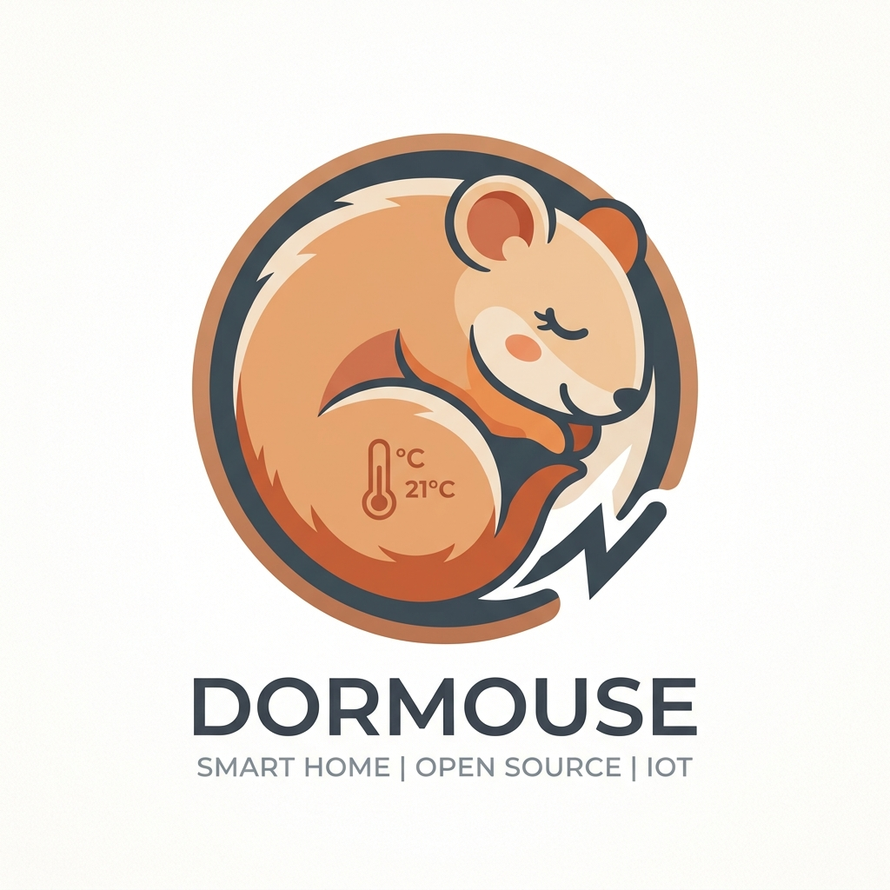
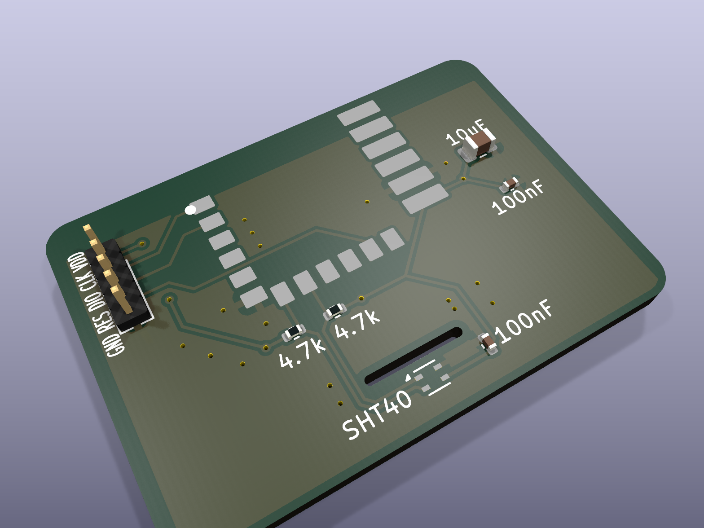
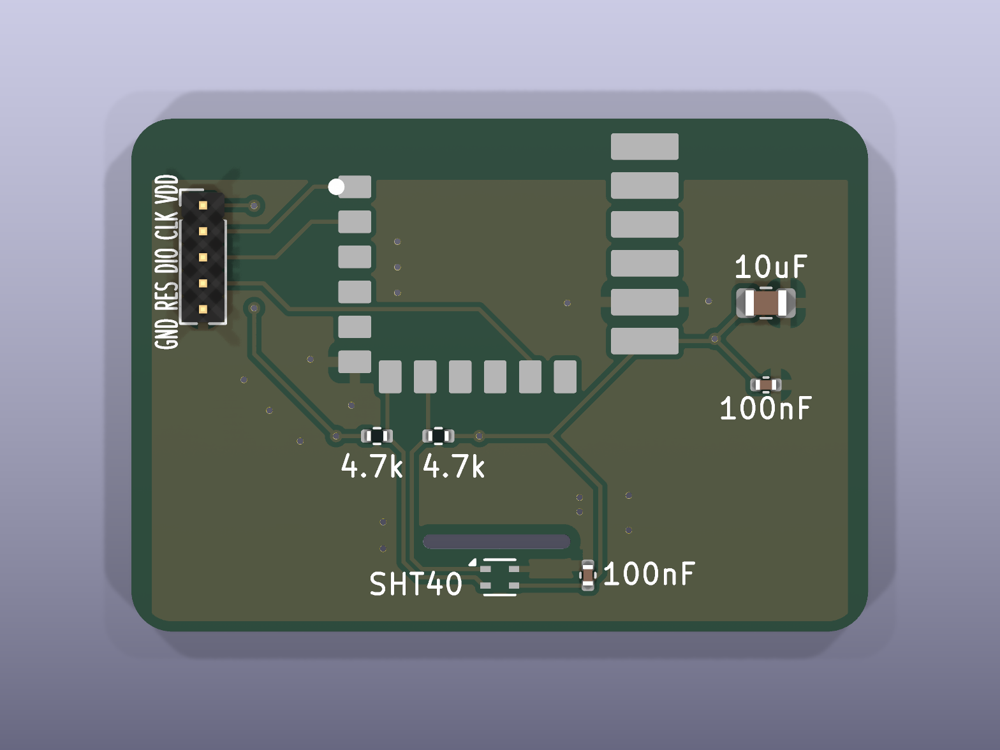
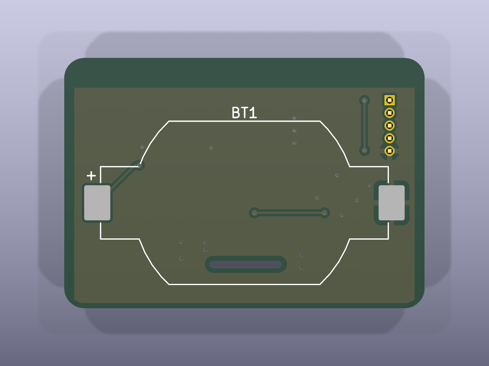
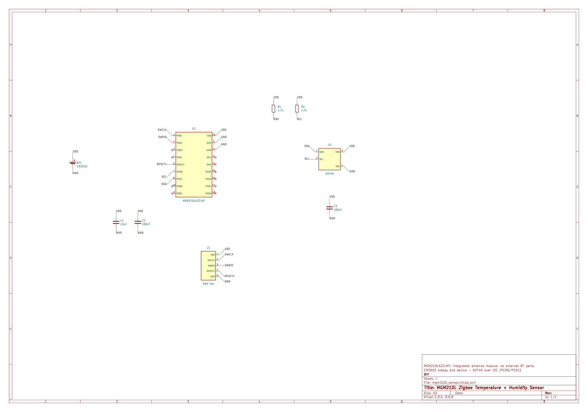

<div align="center">



# 🐭 Dormouse

**A tiny, coin-cell Zigbee climate sensor that hibernates like its namesake — years on a CR2032, and joins Home Assistant with zero cloud.**



[](https://github.com/temonuv/dormouse/actions/workflows/ci.yml)
[-2f6db3)](https://www.silabs.com/wireless/zigbee)
[](https://csa-iot.org/all-solutions/zigbee/)
[](https://github.com/SiliconLabs/simplicity_sdk)
[](https://www.home-assistant.io/integrations/zha/)
[](#-license)

</div>

---

## What it is

**Dormouse** is a from-scratch, open-hardware **temperature + humidity sensor** on the
Silicon Labs **MGM210LA22JNF2** module (EFR32MG21, Cortex-M33, 2.4 GHz). It's a Zigbee
**sleepy end device**: it wakes every 5 minutes, reads an external **Sensirion SHT40**
over I²C, reports temperature, relative humidity and battery level over Zigbee, then
drops back to EM2 sleep. On a single **CR2032** that budgets out to **multi-year**
battery life. No hub beyond your existing Zigbee coordinator, no cloud, no vendor lock-in.

> **Why "Dormouse"?** A dormouse hibernates and briefly stirs to feed — which is
> exactly what a Zigbee sleepy end device does: sleep deep in EM2, wake for a few
> milliseconds every five minutes, report, and doze off again.

Everything is here: **firmware**, a **custom KiCad schematic + routed 2-layer PCB**,
a **datasheet-exact module footprint**, the **manufacturing files**, and the
**Home Assistant integration**.

## ✨ Highlights

- 🔋 **Coin-cell native** — sleepy end device, EM2 sleep, TX power capped so a CR2032 never browns out. ~1–3 µA average.
- 🌡️ **Real ambient temp + humidity** — external SHT40 (±0.2 °C / ±1.8 %RH), CRC-checked, one-shot read per wake.
- 🏠 **Zero-config Home Assistant** — temperature, humidity and battery auto-expose over **ZHA**; a ready-made **Zigbee2MQTT** converter is included.
- 🐞 **Runtime debug mode** — flip a switch in HA to drop to 10 s sampling and stream a live log line, over a manufacturer-specific Zigbee cluster. Auto-off on boot so it never drains the cell.
- 🛡️ **Self-healing** — software watchdog (spans the multi-minute sleep), I²C bus recovery, and a **button-less factory reset** (power-cycle 5× quickly → re-commission).
- 🛠️ **Fully open & reproducible** — headless `slc generate` → build → flash; schematic + footprint generated by scripts; DRC-clean routed board; Gerbers included.

---

## 📸 Gallery

| Top | Bottom (CR2032 holder) |
|:---:|:---:|
|  |  |

<div align="center"></div>

---

## 🧩 How it works

```
         ┌──────────────────────────── every 5 min (10 s in debug) ────────────────────────────┐
         │                                                                                      │
   wake ─┤  SHT40 read (I²C, CRC)  →  IADC battery read  →  write ZCL attrs  →  reporting  →  EM2 sleep
         │        temp + RH               VDD via AVDD/4        temp/RH/batt      pushes to
         │                                                                        coordinator
         └──────────────────────────────────────────────────────────────────────────────────────┘

  ZCL model (endpoint 1, HA Temperature Sensor 0x0302):
    Basic · Power Config · Identify · Temperature (0x0402) · Humidity (0x0405) · MGM Debug (0xFC10)
```

The `.slcp` manifest is the **source of truth** for components, the target part,
sleepy-device timing and TX power. The ZCL data model lives in a ZAP file; the
`#define`s in `src/app.h` mirror it. See [`CLAUDE.md`](CLAUDE.md) for the full
architecture write-up.

---

## 🔧 Hardware

Tiny **2-layer, ~36 × 25 mm** board. The MGM210L sits at the top edge with its
**integrated antenna** pointing off-board and a copper keepout around it; the
CR2032 holder is on the back; the SHT40 is at the bottom edge for airflow.

### Bill of materials

| Ref | Part | Purpose |
|-----|------|---------|
| U1 | **MGM210LA22JNF2** | MCU + Zigbee radio (integrated antenna) |
| U2 | **Sensirion SHT40** (SHT40-AD1B) | Temp + humidity, I²C 0x44 |
| BT1 | CR2032 SMD holder | Power (~220 mAh) |
| R1, R2 | 4.7 kΩ (0402) | I²C pull-ups |
| C1 | 10 µF (0805) | Bulk decoupling — sources the TX pulse |
| C2, C3 | 100 nF (0402) | HF decoupling (module + sensor) |
| J1 | 1×5 1.27 mm header | SWD / RTT debug |

Full wiring, pinout and CR2032 power design: **[`docs/hardware.md`](docs/hardware.md)**.
KiCad sources, custom libraries and PCB notes: **[`hardware/README.md`](hardware/README.md)**.
Manufacturing files (Gerbers, drill, BOM, pick-and-place): **[`hardware/fab/`](hardware/fab/)**.

---

## 🚀 Build & flash

There is **no host/unit-test suite** — this is on-target firmware. "Testing" means
flashing and watching the join + reports over RTT and in ZHA/Z2M. The toolchain is
installed via **SLT** (Silicon Labs Tool).

```bash
# one-time: install SDK 2026.6.0 + slc/gcc/zap/commander
slt install -f tools/pkg.slt

source tools/env.sh      # puts slc, arm-none-eabi-gcc, commander, zap on PATH
tools/build.sh           # slc generate (runs ZAP) + make  ->  build/…/*.s37
tools/flash.sh           # commander flash over J-Link
commander rtt --device MGM210LA22JNF   # live device logs
```

Then put your Zigbee network in join mode (ZHA: *Add device*; Z2M: `permit_join`)
and power the sensor. Verified working with SDK 2026.6.0, slc-cli 6.0.22, GCC 14.2.

---

## 🏠 Home Assistant

- **ZHA** — temperature, humidity and battery are **zero-config** (standard clusters).
  The custom debug cluster needs a small [ZHA quirk](https://github.com/zigpy/zha-device-handlers) to expose.
- **Zigbee2MQTT** — drop [`integration/zigbee2mqtt/dormouse.js`](integration/zigbee2mqtt/dormouse.js)
  in as an external converter. It exposes temperature, humidity, battery, and the
  debug entities (`debug_mode` switch, `debug_log`, `debug_status`, `sample_interval`).

---

## 🗂️ Repository layout

| Path | What |
|------|------|
| `mgm210l_zigbee_temp.slcp` | Project manifest — components, target, config. **Source of truth.** |
| `src/` | Firmware: measurement loop, SHT40 driver, battery, debug mode, watchdog, factory reset. |
| `config/zcl/` | ZCL data model (ZAP) + custom debug-cluster XML. |
| `hardware/` | KiCad schematic + routed PCB, custom symbol/footprint libraries, generators. |
| `hardware/fab/` | Gerbers, drill, BOM, pick-and-place — ready to send to a fab. |
| `integration/zigbee2mqtt/` | Z2M external converter. |
| `docs/` | Hardware guide + rendered images. |
| `tools/` | Headless build / flash / env scripts. |
| `CLAUDE.md` | Deep-dive architecture & rationale (great first read for contributors). |

---

## 🗺️ Roadmap

### ✅ Done
- [x] Firmware builds end-to-end (`slc generate` → compile → link → flashable `.s37`)
- [x] ZCL model: temperature, humidity, power config, + manufacturer debug cluster (`0xFC10`)
- [x] SHT40 I²C driver — CRC-8 verified, with automatic I²C bus recovery + one retry
- [x] Battery sensing via internal IADC (no divider), with a bounded busy-wait guard
- [x] Sleepy-end-device power model (EM2 sleep, 300 s poll, 8 dBm TX cap)
- [x] Runtime debug mode (HA-controlled 10 s cadence + live log), auto-off on boot
- [x] Software watchdog (sleeptimer-based, spans multi-minute sleep)
- [x] Button-less power-cycle factory reset (5× quick cycles → re-commission)
- [x] Custom, datasheet-exact MGM210LA22JNF land pattern + symbol library
- [x] 2-layer PCB fully routed, GND pours with antenna keepout, **0 copper DRC errors**
- [x] Manufacturing package generated (Gerbers / drill / BOM / pick-and-place)
- [x] **PCBs ordered** 🎉
- [x] Zigbee2MQTT converter + ZHA zero-config path
- [x] GitHub Actions CI — repo + device-identity checks on every push (`ci.yml`); firmware `.s37` build & release via a self-hosted runner (`firmware.yml`)

### 🔜 Next (hardware bring-up)
- [ ] Assemble the boards (reflow / hand-solder), first power-on
- [ ] Flash and confirm join + temperature/humidity/battery reports in ZHA & Z2M
- [ ] Verify TX power reads 8 dBm on RTT after a warm-reboot join
- [ ] Confirm `FACTORY_RESET_NVM3_KEY` has no stack-key collision; test the 5× power-cycle reset
- [ ] Double-check `config/sl_i2cspm_sensor_config.h` pins match the built board (PC00/PC01)
- [ ] Measure real sleep current & validate multi-year battery estimate

### 💡 Ideas / help wanted
- [ ] ZHA quirk (zha-device-handlers) so the debug cluster shows up as HA entities
- [ ] 3D model for the custom MGM210L footprint (nicer renders + mechanical check)
- [ ] 3D-printed enclosure / vented case for the SHT40
- [ ] Production build profile (drop `segger_rtt` / `iostream_rtt` to shave idle current)
- [ ] Si7021 sensor variant (swap command byte + conversion only)
- [ ] Zigbee OTA firmware update support
- [ ] Nudge the one SDA trace to clear the cosmetic 0.05 mm edge-clearance DRC note

---

## 🤝 Contributing

Issues and PRs welcome — especially hardware bring-up reports, battery-life data,
and the "help wanted" items above. Please read [`CLAUDE.md`](CLAUDE.md) first; it
explains the two-stage build, the `.slcp`-is-truth rule, and the ZCL/`app.h`/converter
sync requirement that's easy to trip over.

## 📄 License

MIT — see [`LICENSE`](LICENSE). Firmware builds against the Silicon Labs Simplicity
SDK, which carries its own (permissive) license; it is **not** vendored here — the
build fetches it via SLT.

## 🙏 Acknowledgements

- Silicon Labs — EFR32MG21 / MGM210L, Simplicity SDK, Zigbee stack.
- Sensirion — SHT4x sensor family.
- The **KiCad**, **Freerouting**, and **Zigbee2MQTT** projects.
